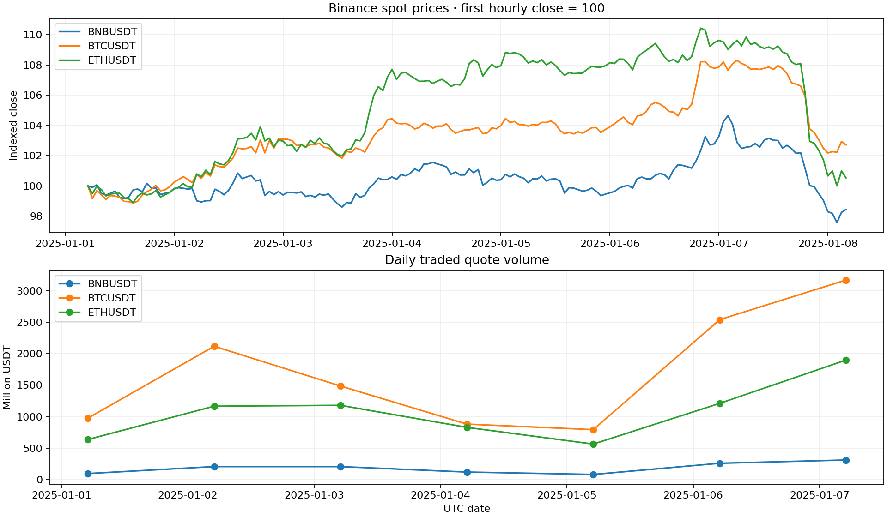
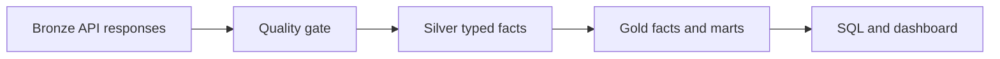

# Binance Crypto Medallion Pipeline

A standalone Python and DuckDB project that downloads real API responses, validates typed Silver facts, and publishes versioned Gold analytics. This repository includes source code, a real API response sample and measured execution evidence. Run the pipeline to create the complete local dataset. A separately distributed data ZIP includes the full Bronze download and a validated publication for offline replay.

**Executed dataset:** 3 symbols · 2025-01-01 through 2025-01-07 UTC · 30,240 one-minute candles.



## Architecture



## Quick start

Use Python 3.11 or 3.12 on macOS/Linux. Docker is an optional alternative. From **this project folder**:

```bash
python3.11 -m venv .venv
source .venv/bin/activate
pip install -r requirements.txt
python run.py run
python run.py status
```

### Offline replay from the separately distributed data ZIP

```bash
python run.py build --run-id 20261101T090959Z_8cf668e6
python report.py
python -m unittest discover -s tests -v
python verify_integration.py
```

The commands in this subsection require the full `data/` directory supplied in the data ZIP; that directory is intentionally excluded from a source-only Git clone. Dependency installation still requires network access unless packages are cached. Offline replay only avoids API downloads. The integration script checks the shipped default dataset, injects a failure before publication and then replays the same Bronze run.

### Download again and process

```bash
python run.py run
```

Change the date window with explicit inclusive start and exclusive end:

```bash
python run.py run --start 2025-01-08 --end 2025-01-10
```

New ranges are upserted into the previously published Silver facts by their natural keys. Watermarks record validated coverage; they are not used to silently skip API calls. Replay the same range to process upstream corrections. All prices/dates/units are described below.

### Dashboard

```bash
streamlit run dashboard.py
```

Open the URL printed by Streamlit, usually http://localhost:8501. Run one project's dashboard at a time, or choose another port. This dashboard explores a historical batch publication; it is not a live WebSocket service.

## Where raw data is stored

The complete API response bodies are in:

```text
data/bronze/20261101T090959Z_8cf668e6/
```

The manifest alongside them records the URL, HTTP status, retrieval time, byte count, SHA-256 hash and run configuration. Payload files are created once and never rewritten by a build. Checksum verification happens before every replay.

Silver Parquet is under `data/silver/<publication_id>/`. Gold Parquet, CSV and a portable DuckDB database are under `data/gold/<publication_id>/`. The relative paths of the validated release are listed in `data/current.json`. Open that file instead of guessing which timestamped folder is current.

## Publication and recovery

1. Download all requested responses into a new Bronze run.
2. Verify response hashes, schema and record-level rules.
3. Persist quarantine details; block publication if any row is rejected or the required timestamp grid is incomplete.
4. Merge new Silver facts with the current release, replacing matching natural keys.
5. Build a candidate DuckDB warehouse and reconcile its outputs.
6. Atomically replace `data/current.json` only after all gates pass. The same pointer includes the watermarks.

The writer uses a local filesystem lock. Interrupted or rejected runs can leave unreferenced candidate directories, but consumers continue to read the last validated release. This is an application-level snapshot protocol on one filesystem, not Delta Lake or a distributed transaction protocol.

## Validation evidence

See [evidence/verification.json](evidence/verification.json), [unit test output](evidence/unit_tests.txt), [measured metrics](evidence/summary.json) and [verification notes](VERIFICATION.md). The chart above is generated from actual Gold data.

## Repository publishing

Publish each project as its own GitHub repository. Source code, tests, SQL, small source samples and evidence are ready to commit. `data/` and `reports/` are ignored to keep large local snapshots out of ordinary commits. The downloadable ZIP deliberately includes those directories because it is a reproducible data release. Preserve API attribution and source terms when redistributing data.

## Optional Docker commands

```bash
docker compose run --build --rm pipeline status
docker compose run --rm pipeline build --run-id 20261101T090959Z_8cf668e6
docker compose up --build dashboard
```

The image uses Python 3.11; mounted `data/` and `reports/` preserve publications. Docker image construction is not part of the recorded local validation.

## Source and data model

Source: Binance Spot REST market data. This project calls the official market-data-only host `https://data-api.binance.vision`; it requires no trading credentials. It paginates `/api/v3/klines` with a 1,000-record page size and stores `exchangeInfo` for symbol labels. API errors are kept in the failed Bronze manifest. The regular api.binance.com host returned HTTP 451 in the preparation environment; the official public market-data-only host worked.

These are exchange-provided candlesticks, not individual trade events. A record is identified by `(symbol, open_time)`. Times are UTC. Monetary/volume values use DECIMAL(28,10) in Silver; VWAP and ratios are DOUBLE in Gold. BTC/USDT and other USDT quotes are not assumed to be USD.

| Layer | Stored data | Main rules |
|---|---|---|
| Bronze | 33 kline page bodies and one exchange metadata body | Preserve bytes and verify hashes |
| Silver | 30,240 typed one-minute candle facts | Required fields, timestamp range/alignment, OHLC bounds, nonnegative volume, taker volume <= total, unique natural key |
| Gold | Symbol/date dimensions, hourly and daily marts | Reconcile exact base/quote volume and trade counts; mark bucket completeness |

OHLC uses the first open, highest high, lowest low and last close. VWAP is `SUM(quote_volume) / SUM(base_volume)` with a null result for a zero denominator. It uses the exchange's traded volume fields, not an average of candle closes. Taker buy share is based on quote-volume fields and does not measure order-book pressure. An incomplete bucket remains visible with `is_complete = false`; filter it when comparing complete periods.

## SQL examples

See [queries.sql](queries.sql). In Python:

```python
from src.storage import read_current_sql
print(read_current_sql("SELECT * FROM gold.mart_daily ORDER BY symbol, bucket_time"))
```

## Limitations

Batch backfill only; no live streaming, derivatives, order execution or forecasting. Explicit historical windows must be complete and minute-aligned. The default quality gate rejects a missing candle rather than inventing one. A historical symbol that has no data for a period will therefore require a deliberately revised completeness policy. The fixed 10-decimal scale is appropriate for the shipped pairs but must be reviewed before adding other assets. Source payloads remain subject to Binance terms.

## References

- https://developers.binance.com/en/docs/
- https://developers.binance.com/docs/binance-spot-api-docs/rest-api/market-data-endpoints
- https://developers.binance.com/docs/binance-spot-api-docs/faqs/market_data_only
